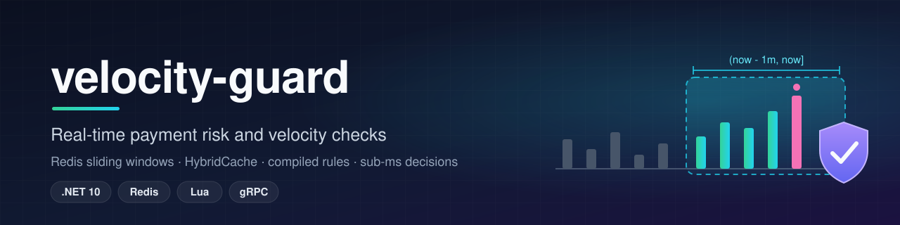
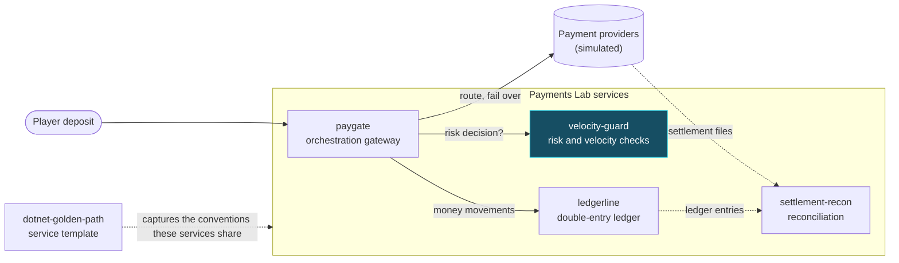
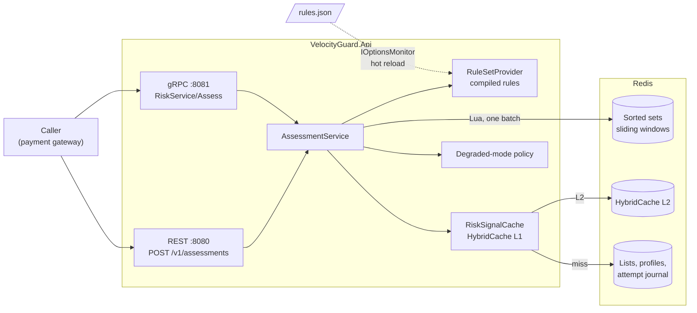
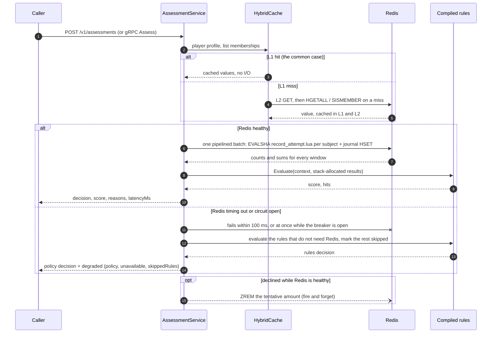

<div align="center">



# 🛡️ VelocityGuard

**Real-time risk and velocity checks for payments: Redis sliding windows, a two-level HybridCache and a rules engine that answers in well under a millisecond.**

[](https://github.com/AutumnTrace/velocity-guard/actions/workflows/ci.yml)
[](https://github.com/AutumnTrace/velocity-guard/actions/workflows/codeql.yml)
[](https://github.com/AutumnTrace/velocity-guard/releases)


[](LICENSE)

[Quick start](#-quick-start) · [Architecture](#-architecture) · [Examples](#-example-requests-and-responses) · [Rules](#-rules) · [Design decisions](#-design-decisions) · [Benchmarks](#-benchmarks) · [Changelog](CHANGELOG.md)

</div>

---

## 💡 Why this exists

Every deposit on a betting or casino platform has to be risk-checked before it reaches a payment provider, and the check sits directly on the payment path: if it is slow, every deposit is slow; if it is down, nobody can deposit. Most of the fraud it has to catch is about *speed*, not single transactions: a stolen card tested with ten small deposits in a minute, one device cycling through cards, a fresh account depositing far more than its history suggests. Catching that needs exact counters over sliding time windows, shared by every instance of the service, plus fast access to block lists and player history. VelocityGuard is that check: a small, fast, explainable decision (`approve`, `review`, `decline`) with every reason spelled out, that degrades on purpose instead of falling over when Redis does.

## ✨ Features

| | |
|---|---|
| ⏱️ **Exact sliding windows** | Sorted sets in Redis, half-open windows to the millisecond; counts and per-currency sums per player, device, IP (IPv6 by /64) and card token |
| ⚛️ **One atomic round trip** | One Lua script per subject updates and reads every window atomically; all subjects go out as one pipelined batch, cluster-safe through hash tags |
| 🧮 **Compiled rules** | Nine rule types from `rules.json`, compiled into slot-indexed structs; evaluation allocates nothing (asserted by a test and by BenchmarkDotNet) |
| 🔁 **Hot reload** | Edit `rules.json` and the next request uses it; invalid edits are rejected and counted while the last good set keeps serving |
| 🗂️ **Two-level cache** | HybridCache (memory + Redis) for player profiles and block/allow lists, key eviction for single changes, tag invalidation for whole lists |
| 🧯 **Designed degradation** | Circuit breaker around a 100 ms timeout on every Redis call; `FailOpen`, `Review` or `FailClosed` policy, reported in the response and in metrics |
| 🔄 **Outcomes feed back** | PSP declines release amounts from sum windows; chargebacks flag the player and block the card and device |
| 🕶️ **Shadow rules** | Try a rule on live traffic: hits are reported and measured but never change a decision |
| 📡 **REST and gRPC** | JSON on 8080, protobuf over HTTP/2 on 8081 for internal callers; one engine, one validation path |
| 🔍 **Explainable** | Every response lists the reasons in plain words, every evaluated rule and the rules version that decided it |
| 📊 **Observable** | Serilog, OpenTelemetry traces and metrics (decisions, rule hits, latency, cache hit ratio, degraded decisions), OTLP or Azure Monitor |
| 🔒 **Careful with data** | Money as `long` minor units with ISO 4217 currency; card numbers are refused, never logged; admin API behind a constant-time key check |
| 🧪 **Tested** | Unit, property-based, HTTP and gRPC tests, plus a Testcontainers suite on real Redis including an outage |

## 🧩 Part of Payments Lab

VelocityGuard is one of five .NET services built around the payments side of an online sportsbook and casino platform. Each one runs and tests on its own.

| Repository | What it does |
|---|---|
| [paygate](https://github.com/AutumnTrace/paygate) | Payment orchestration gateway: PSP routing and failover, Polly circuit breakers, idempotent REST API, signed webhooks |
| [ledgerline](https://github.com/AutumnTrace/ledgerline) | Double-entry wallet ledger: DDD + CQRS on EF Core/PostgreSQL, optimistic concurrency, transactional outbox to Kafka |
| [settlement-recon](https://github.com/AutumnTrace/settlement-recon) | Settlement reconciliation engine: streams PSP settlement files against the ledger, explains every mismatch |
| **[velocity-guard](https://github.com/AutumnTrace/velocity-guard)** 📍 **you are here** | **Real-time payment risk and velocity checks on Redis: sliding windows, HybridCache, sub-millisecond rule evaluation** |
| [dotnet-golden-path](https://github.com/AutumnTrace/dotnet-golden-path) | `dotnet new` template for production .NET services: OpenTelemetry, Serilog, resilience, Testcontainers, Docker, Helm, CI |



## 🚀 Quick start

### Option A: just .NET (in-memory, nothing else to install)

```bash
git clone https://github.com/AutumnTrace/velocity-guard.git
cd velocity-guard
dotnet run --project src/VelocityGuard.Api --launch-profile http
```

REST is on **http://localhost:5380** (try `GET /v1/rules`, or the OpenAPI document at `/openapi/v1.json`), gRPC on **http://localhost:5381**. Velocity, lists and profiles live in memory; the admin key in development is `dev-admin-key-change-me`.

### Option B: Docker Compose (Redis + dashboard)

```bash
docker compose up --build
```

The API is on **http://localhost:8080** (gRPC on 8081), backed by Redis 8.10. Traces and metrics are exported over OTLP to the Aspire dashboard at **http://localhost:18888**. The admin key is `docker-demo-admin-key`.

### Option C: prebuilt image

Each release is published to GitHub Container Registry:

```bash
docker run --rm -p 8080:8080 -p 8081:8081 ghcr.io/autumntrace/velocity-guard:0.1.0
```

This uses the in-memory store. Point it at Redis with `-e Storage__Provider=Redis -e ConnectionStrings__Redis=<host>:6379`.

## 🏗 Architecture



`VelocityGuard.Core` holds the domain (money, attempts, rules, compiler, evaluator, assessment pipeline) and an in-memory store; it knows nothing about Redis or HTTP. `VelocityGuard.Redis` implements the store, the journal and the repository on Redis with the resilience pipeline. `VelocityGuard.Api` is the host.

### An assessment, step by step



## 🧪 Example requests and responses

Everything below is a real response from the service (`dotnet run -c Release`, shipped `rules.json`, in-memory storage), captured with curl after a short warm-up. `latencyMs` is measured inside the service, from the start of the assessment to the decision. After the first example, `evaluatedRules` (the same 15 rule ids every time) is left out to keep this page short.

### ✅ Approve: a routine deposit

```bash
curl -s -X POST http://localhost:5380/v1/assessments \
  -H "Content-Type: application/json" \
  -d '{
        "attemptId": "att_0193a1f0",
        "playerId": "p-1042",
        "amount": 25.00,
        "currency": "EUR",
        "method": "card",
        "ip": "203.0.113.10",
        "ipCountry": "DE",
        "card": { "binCountry": "DE", "fingerprint": "fp_9f2c4e1a77" },
        "deviceId": "dev-7f3a",
        "accountAgeDays": 420
      }'
```

```json
{
  "attemptId": "att_0193a1f0",
  "decision": "approve",
  "score": 0,
  "reasons": [],
  "evaluatedRules": [
    "blocked-device", "blocked-card", "blocked-ip", "trusted-player",
    "device-burst-1m", "player-attempts-10m", "card-attempts-1h", "ip-attempts-1h",
    "player-deposits-24h", "card-deposits-7d", "large-amount", "bin-ip-country-mismatch",
    "new-account-large-deposit", "first-deposit-large", "chargeback-history"
  ],
  "rulesVersion": "3161c0c62ff4",
  "latencyMs": 0.045
}
```

### 🟠 Review: a large deposit from a two-day-old account, with a foreign card

```bash
curl -s -X POST http://localhost:5380/v1/assessments \
  -H "Content-Type: application/json" \
  -d '{
        "attemptId": "att_0193a1f1",
        "playerId": "p-2087",
        "amount": 600.00,
        "currency": "EUR",
        "method": "card",
        "ip": "198.51.100.23",
        "ipCountry": "DE",
        "card": { "binCountry": "BR", "fingerprint": "fp_0c11aa29e3" },
        "deviceId": "dev-11ab",
        "accountAgeDays": 2
      }'
```

```json
{
  "attemptId": "att_0193a1f1",
  "decision": "review",
  "score": 55,
  "reasons": [
    {
      "rule": "new-account-large-deposit",
      "type": "newAccountAmount",
      "score": 30,
      "message": "Account is 2 days old and 600.00 EUR is at or above 500.00 EUR"
    },
    {
      "rule": "bin-ip-country-mismatch",
      "type": "countryMismatch",
      "score": 25,
      "message": "Card issued in BR, IP located in DE"
    }
  ],
  "rulesVersion": "3161c0c62ff4",
  "latencyMs": 0.063
}
```

### ⛔ Decline: a device on the blocklist

An analyst blocks a device through the admin API, and the next attempt from it is declined:

```bash
curl -s -X PUT http://localhost:5380/v1/lists/blocked-devices/entries/dev-5e19 \
  -H "X-Admin-Key: dev-admin-key-change-me"
```

```json
{ "list": "blocked-devices", "value": "dev-5e19", "changed": true }
```

```bash
curl -s -X POST http://localhost:5380/v1/assessments \
  -H "Content-Type: application/json" \
  -d '{
        "attemptId": "att_0193a1f3",
        "playerId": "p-3311",
        "amount": 50.00,
        "currency": "EUR",
        "method": "card",
        "ip": "192.0.2.44",
        "ipCountry": "DE",
        "card": { "binCountry": "DE", "fingerprint": "fp_77e0b2c4d1" },
        "deviceId": "dev-5e19",
        "accountAgeDays": 30
      }'
```

```json
{
  "attemptId": "att_0193a1f3",
  "decision": "decline",
  "score": 100,
  "reasons": [
    {
      "rule": "blocked-device",
      "type": "blocklist",
      "score": 100,
      "action": "decline",
      "message": "This device is on the 'blocked-devices' list"
    }
  ],
  "rulesVersion": "3161c0c62ff4",
  "latencyMs": 0.079
}
```

<details>
<summary><b>Card testing</b>: four small deposits from one device, each with a different card, inside a minute</summary>

```bash
for i in 1 2 3 4; do
  curl -s -X POST http://localhost:5380/v1/assessments \
    -H "Content-Type: application/json" \
    -d "{\"attemptId\":\"att_0193a20$i\",\"playerId\":\"p-60$i\",\"amount\":5.00,\"currency\":\"EUR\",
         \"method\":\"card\",\"ip\":\"203.0.113.88\",\"ipCountry\":\"DE\",
         \"card\":{\"binCountry\":\"DE\",\"fingerprint\":\"fp_test_card_0$i\"},
         \"deviceId\":\"dev-9c0d\",\"accountAgeDays\":15}"
done
```

The first three are approved; the fourth trips the device window:

```json
{
  "attemptId": "att_0193a204",
  "decision": "review",
  "score": 50,
  "reasons": [
    {
      "rule": "device-burst-1m",
      "type": "velocityCount",
      "score": 50,
      "message": "4 attempts from this device in 1m (max 3)"
    }
  ],
  "rulesVersion": "3161c0c62ff4",
  "latencyMs": 0.063
}
```
</details>

<details>
<summary><b>Outcomes</b>: an approved deposit is charged back, and the player's next attempt is declined</summary>

```bash
curl -s -X POST http://localhost:5380/v1/assessments/att_0193a1f0/outcome \
  -H "Content-Type: application/json" -d '{ "outcome": "approved" }'

curl -s -X POST http://localhost:5380/v1/assessments/att_0193a1f0/outcome \
  -H "Content-Type: application/json" -d '{ "outcome": "chargeback" }'
```

```json
{
  "attemptId": "att_0193a1f0",
  "outcome": "chargeback",
  "previous": "approved",
  "status": "recorded",
  "profile": {
    "approvedDeposits": 1,
    "chargebacks": 1,
    "lastApprovedAt": "2026-11-23T13:06:39.2351641+00:00"
  },
  "blockedOn": ["blocked-cards", "blocked-devices"]
}
```

The same player, card and device try again (`att_0193a1f4`, 40.00 EUR):

```json
{
  "attemptId": "att_0193a1f4",
  "decision": "decline",
  "score": 100,
  "reasons": [
    { "rule": "blocked-device", "type": "blocklist", "score": 100, "action": "decline", "message": "This device is on the 'blocked-devices' list" },
    { "rule": "blocked-card", "type": "blocklist", "score": 100, "action": "decline", "message": "This card is on the 'blocked-cards' list" },
    { "rule": "chargeback-history", "type": "chargebackHistory", "score": 60, "action": "review", "message": "Player has 1 chargeback(s) on record" }
  ],
  "rulesVersion": "3161c0c62ff4",
  "latencyMs": 0.084
}
```

Outcomes follow `none → approved | declined` and `approved → chargeback`; anything else is a `409` problem. A `declined` outcome takes the amount back out of the sum windows.
</details>

<details>
<summary><b>Degraded mode</b>: Redis unreachable, policy <code>Review</code></summary>

A second instance configured for Redis, pointed at a port where nothing listens (`Storage__Provider=Redis`, `ConnectionStrings__Redis=127.0.0.1:6390`). The circuit is open, so nothing waits on a timeout; the rules that do not need Redis still run, and the policy turns their `approve` into a `review`:

```json
{
  "attemptId": "att_0193a2e9",
  "decision": "review",
  "score": 0,
  "reasons": [],
  "evaluatedRules": ["large-amount", "bin-ip-country-mismatch", "new-account-large-deposit"],
  "degraded": {
    "policy": "review",
    "unavailable": ["risk-data", "velocity-store"],
    "skippedRules": [
      "blocked-device", "blocked-card", "blocked-ip", "trusted-player",
      "device-burst-1m", "player-attempts-10m", "card-attempts-1h", "ip-attempts-1h",
      "player-deposits-24h", "card-deposits-7d", "first-deposit-large", "chargeback-history"
    ],
    "rulesDecision": "approve"
  },
  "rulesVersion": "3161c0c62ff4",
  "latencyMs": 1.239
}
```

Readiness stays HTTP 200 with `"status": "Degraded"` and `"description": "Redis unreachable; assessments follow the degraded-mode policy"` for the `redis` check. (That instance ran with Development logging, which writes a debug line to the console per request; most of the 1.2 ms is that.)
</details>

<details>
<summary><b>Invalid input</b>: every problem at once, as RFC 9457 problem details, and the card number is not echoed</summary>

```bash
curl -s -X POST http://localhost:5380/v1/assessments \
  -H "Content-Type: application/json" \
  -d '{ "playerId": "p-1042", "amount": 10.005, "currency": "EUR", "method": "card",
        "ip": "10.1", "ipCountry": "DE",
        "card": { "binCountry": "DE", "fingerprint": "4111 1111 1111 1111" },
        "accountAgeDays": 3 }'
```

```http
HTTP/1.1 400 Bad Request
Content-Type: application/problem+json
```

```json
{
  "type": "https://tools.ietf.org/html/rfc9110#section-15.5.1",
  "title": "The payment attempt is invalid.",
  "status": 400,
  "errors": {
    "amount": ["EUR allows at most 2 decimal places"],
    "ip": ["must be a valid IPv4 or IPv6 address"],
    "card.fingerprint": ["looks like a card number; send the PSP token or fingerprint instead, never the PAN"]
  },
  "traceId": "00-f68e897aeccc315668fb483ac8c1609d-d73808b3053b1549-03"
}
```
</details>

<details>
<summary><b>gRPC</b>: the same assessment over HTTP/2, amounts in minor units</summary>

The contract is [`risk.proto`](src/VelocityGuard.Api/Protos/velocityguard/v1/risk.proto). A .NET caller:

```csharp
using var channel = GrpcChannel.ForAddress("http://localhost:5381");
var client = new RiskService.RiskServiceClient(channel);

var response = await client.AssessAsync(new AssessRequest
{
    AttemptId = "att_0193a2f7",
    PlayerId = "p-5005",
    AmountMinor = 4500,              // 45.00 EUR
    Currency = "EUR",
    Method = PaymentMethod.Card,
    Ip = "203.0.113.10",
    IpCountry = "DE",
    CardBinCountry = "DE",
    CardFingerprint = "fp_5b1e0c9d42",
    DeviceId = "dev-4c21",
    AccountAgeDays = 310,
});
```

The response, printed with `Google.Protobuf.JsonFormatter`:

```json
{
  "attemptId": "att_0193a2f7",
  "decision": "DECISION_APPROVE",
  "evaluatedRules": [ "blocked-device", "blocked-card", "…", "chargeback-history" ],
  "rulesVersion": "3161c0c62ff4",
  "latencyMs": 0.078
}
```

CI makes the same kind of call against the built container with `grpcurl`.
</details>

## 📏 Rules

Rules live in [`src/VelocityGuard.Api/rules.json`](src/VelocityGuard.Api/rules.json). Each hit adds its score; the total is clamped to 0–100 and compared with two thresholds (`ReviewAt: 40`, `DeclineAt: 80` in the shipped file). A rule can also force a decision with `"Action": "Review"` or `"Decline"`, whatever the score.

| Type | Fires when | Parameters |
|---|---|---|
| `VelocityCount` | more than `MaxCount` attempts for one subject inside the window | `Dimension`, `Window`, `MaxCount` |
| `VelocitySum` | the amount deposited by one subject inside the window exceeds the limit for the attempt's currency | `Dimension`, `Window`, `Limits` |
| `AmountThreshold` | a single amount is at or above the limit for its currency | `Limits` |
| `CountryMismatch` | the card's BIN country differs from the IP's country (cards only) | |
| `NewAccountAmount` | the account is younger than `MaxAccountAgeDays` and the amount is at or above the limit | `MaxAccountAgeDays`, `Limits` |
| `FirstDeposit` | the player has no approved deposit yet (and the amount is at or above the limit, if one is set) | `Limits` (optional) |
| `ChargebackHistory` | the player has at least `MinChargebacks` chargebacks on record | `MinChargebacks` |
| `Blocklist` | the subject is on the named list | `List`, `Dimension` |
| `Allowlist` | the subject is on the named list (score must be ≤ 0) | `List`, `Dimension` |

`Dimension` is `Player`, `Device`, `Ip` (IPv6 counted per /64) or `Card` (the PSP token). Windows run from one second to 31 days; `Limits` are major units per ISO 4217 currency, and a currency without a limit simply does not trigger that rule.

```json
{
  "Id": "device-burst-1m",
  "Type": "VelocityCount",
  "Dimension": "Device",
  "Window": "00:01:00",
  "MaxCount": 3,
  "Score": 50,
  "Description": "Burst of attempts from one device: the classic card-testing pattern"
},
{
  "Id": "card-deposits-7d",
  "Type": "VelocitySum",
  "Dimension": "Card",
  "Window": "7.00:00:00",
  "Limits": { "EUR": 5000, "GBP": 4300, "USD": 5500 },
  "Score": 30,
  "Mode": "Shadow",
  "Description": "Weekly volume on one card; in shadow mode while its threshold is tuned"
}
```

**Hot reload.** Save `rules.json` and the next request runs on the new rule set; the response's `rulesVersion` (a content hash) changes with it. An invalid edit is rejected with every problem logged (`Rejected a rules reload, still running 3161c0c62ff4. Problems: …`), counted in `velocityguard.rules.reloads{result="rejected"}`, and the last good rule set keeps serving. At startup the same validation is strict: the service will not start with rules it cannot run.

**Shadow mode.** `"Mode": "Shadow"` evaluates a rule on live traffic and reports its hits in `shadowHits` and in `velocityguard.rule.hits{mode="shadow"}`, without touching the score or the decision. That is how a new threshold gets tuned before it can block anyone.

`GET /v1/rules` returns the compiled rule set as the service sees it:

```json
{
  "id": "player-deposits-24h",
  "type": "velocitySum",
  "mode": "active",
  "score": 40,
  "action": "score",
  "description": "Deposits by one player in 24 hours above the daily limit",
  "dimension": "player",
  "window": "24h",
  "limits": { "EUR": 2000, "GBP": 1700, "SEK": 22000, "USD": 2200 }
}
```

## 🧠 Design decisions

- **Sorted-set sliding windows, not fixed buckets.** Exact to the millisecond, so a burst cannot hide across a bucket boundary; amounts can be taken back out when a payment fails. → [ADR 0001](docs/adr/0001-sorted-set-sliding-windows.md)
- **One Lua script per subject, all subjects in one pipelined batch.** Atomic where it matters (one card, one device), one round trip per assessment, valid on Redis Cluster. → [ADR 0002](docs/adr/0002-lua-for-atomic-window-updates.md)
- **HybridCache for profiles and lists.** Memory first, Redis second; eviction for single changes, tags for whole lists; no backplane, so other instances converge within the 30 s L1 lifetime. → [ADR 0003](docs/adr/0003-hybridcache-for-profiles-and-lists.md)
- **A configurable degraded-mode policy.** Fail open, review or fail closed is a business decision; the circuit breaker makes it fast and the response makes it visible. → [ADR 0004](docs/adr/0004-degraded-mode-policy.md)
- **Rules as configuration, compiled into structs.** Analysts change thresholds without a deploy; the hot path is a loop over an array with no allocation. → [ADR 0005](docs/adr/0005-compiled-rules.md)

<details>
<summary><b>Other details</b></summary>

- **IPv6 is counted per /64.** A subscriber usually owns a whole /64, so per-address velocity is trivially evaded.
- **Idempotent by attempt id.** Members are attempt ids added with `ZADD NX`: a retried assessment is counted once, and keeps its first timestamp.
- **Strict validation, precise errors.** Every invalid field is reported at once as RFC 9457 problem details; values that look like a card number are rejected without being echoed.
- **Shared contract tests.** One test suite pins the window semantics and runs against both the in-memory store and Redis.
- **Liveness never checks Redis.** A Redis blip must not restart pods; readiness reports `Degraded` and the service keeps answering under its policy.

</details>

## ✅ Testing

```bash
dotnet test --filter "Category!=Integration"   # 176 unit, property-based, HTTP and gRPC tests; no Docker
dotnet test --filter "Category=Integration"    # 24 Testcontainers tests against Redis 8.10; needs Docker
```

CI runs both on every push and pull request, publishes a coverage summary, builds the image and smoke-tests it over REST and gRPC, and starts the full compose stack to check that velocity is enforced through Redis.

| Suite | What it covers |
|---|---|
| `Rules/*` | Every rule type (hit, pass, not applicable, skipped), thresholds and forcing actions, shadow mode, clamping, the validator's messages, slot and bit de-duplication in the compiler, and a test that evaluation allocates **zero bytes** |
| `Payments/*` | Minor units per currency exponent (EUR, JPY, BHD), amount validation, IPv6 /64 keys, refusal of anything shaped like a card number |
| `Velocity/*` | A shared **store contract** (half-open windows at the exact boundary, per-currency sums, idempotent retries, released amounts, trimming, out-of-order clocks, journal transitions) on a fake `TimeProvider`; an **FsCheck property** that the store matches a brute-force model on random event streams; a concurrency test |
| `Signals/*` | HybridCache read-through, immutable L1 instances, single-key eviction, tag invalidation of a whole list, the list hit mask |
| `Assessment/*` | The pipeline end to end on in-memory storage, each **degraded policy** with its metrics, declines releasing amounts, outcomes and chargeback blocking, **hot reload** through real `IConfiguration` and `IOptionsMonitor` (applied, rejected, unchanged, invalid at startup) |
| `Resilience/*` | The production Redis pipeline around fake stores: timeout, circuit opening, fail-fast while open, caller cancellation, L2 reads while open |
| `Api/*` | `WebApplicationFactory`: approve, review, decline, card testing, problem details, malformed JSON, outcomes, admin lists and key checks, health, OpenAPI, a real **on-disk `rules.json` edit**, refusal to start on invalid rules, the service pointed at a **closed Redis port**, and gRPC |
| `IntegrationTests/*` | Redis via Testcontainers: the same store contract, **400 concurrent attempts from four connections** counted exactly once, TTLs and hash slots, HybridCache **L2 sharing and tag invalidation across instances**, two API instances sharing windows and chargeback blocks, and a `docker pause` **outage** that must degrade fast and recover |

### Observability

| Signal | What you get |
|---|---|
| **Metrics** (meter `VelocityGuard`) | `velocityguard.assessments{decision,degraded}`, `velocityguard.assessment.duration` and `velocityguard.evaluation.duration` (seconds, buckets from 10 µs), `velocityguard.rule.hits{rule,mode}`, `velocityguard.cache.lookups{cache}` and `velocityguard.cache.misses{cache}` (hit ratio), `velocityguard.degraded{policy,dependency}`, `velocityguard.rules.reloads{result}`, `velocityguard.outcomes{outcome}`; plus Polly resilience events, ASP.NET Core and runtime metrics |
| **Traces** | A `velocityguard.assess` span per assessment (rules version, decision, score) under the ASP.NET Core request span; health checks are filtered out |
| **Logs** | Serilog, compact JSON in production; source-generated `LoggerMessage` for the hot and important paths (rules loaded, reloaded or rejected, degraded decisions, outcomes). No card data, IPs or device ids in log messages; attempt and rule ids are enough to find the rest |
| **Export** | OTLP when `OTEL_EXPORTER_OTLP_ENDPOINT` is set (the compose stack sends to the Aspire dashboard); Azure Monitor / Application Insights when `APPLICATIONINSIGHTS_CONNECTION_STRING` is set |
| **Health** | `/health/live` (process only) and `/health/ready` (rules loaded, Redis ping; `Degraded` rather than `Unhealthy` when Redis is down) |

## 📊 Benchmarks

Measured with BenchmarkDotNet on the shipped rules and the production service registrations. Raw reports: [`docs/benchmarks`](docs/benchmarks).

```
BenchmarkDotNet v0.15.8, Windows 11 (10.0.26200.7623/25H2/2025Update/HudsonValley2)
AMD Ryzen 7 9800X3D 4.70GHz, 1 CPU, 16 logical and 8 physical cores
.NET SDK 10.0.401
  [Host]     : .NET 10.0.12 (10.0.12, 10.0.1226.42308), X64 RyuJIT x86-64-v4
```

| Benchmark | Mean | Allocated |
|---|---:|---:|
| Evaluate the 15 shipped rules: clean attempt, no hits | **30.89 ns** | **0 B** |
| Evaluate the 15 shipped rules: risky attempt, 8 hits + 1 shadow | **37.75 ns** | **0 B** |
| Player profile lookup, HybridCache L1 hit | 45.58 ns | 56 B |
| List membership lookup, HybridCache L1 hit | 62.09 ns | 88 B |
| Player profile lookup, miss (evict, load from the store, cache) | 371.66 ns | 720 B |
| In-memory store: record one attempt, read 7 windows for 4 subjects | 1.454 μs | 1.61 KB |
| Whole assessment in process (cache, in-memory store, evaluation, result) | 3.348 μs | 3.01 KB |

What this says, and what it does not:

- The rules engine is not the bottleneck: evaluating every rule costs about as much as one dictionary lookup, and allocates nothing.
- A whole assessment in process costs a few microseconds. With Redis, one network round trip is added (the windows and the journal share it), and that round trip dominates; it is **not** in these numbers.
- The `latencyMs` values in the examples above (45 to 85 µs on a warm process) are timed around the assessment inside the service: signals, velocity and evaluation, but not JSON parsing, routing or the network. They sit above the benchmark because each example uses players, devices and cards the cache has never seen, and the live process also runs tracing and development logging.
- One developer workstation, one run. Use these numbers to compare changes on the same machine, not as a production promise.

```bash
cd benchmarks/VelocityGuard.Benchmarks
dotnet run -c Release -- --filter "*"
```

## ⚙️ Configuration

| Key | Default | Description |
|---|---|---|
| `Risk:RulesFile` | `rules.json` | Rules file (relative to the content root), watched for changes |
| `Storage:Provider` | `InMemory` | `InMemory` or `Redis` |
| `Storage:JournalRetention` | `30.00:00:00` | How long assessed attempts are kept so outcomes and chargebacks can be matched |
| `ConnectionStrings:Redis` | `localhost:6379` | StackExchange.Redis configuration string |
| `Redis:KeyPrefix` | `vg` | Prefix for every key (windows, journal, lists, profiles, cache) |
| `Redis:OperationTimeout` | `00:00:00.100` | Per-call timeout applied by the resilience pipeline |
| `Redis:ClientTimeout` | `00:00:00.250` | The client's own command timeout |
| `Redis:Breaker*` | 50 %, 20 calls, 10 s, 15 s | Circuit breaker: failure ratio, minimum throughput, sampling window, break duration |
| `Degraded:Policy` | `Review` | `FailOpen`, `Review` or `FailClosed`; read live, no restart needed |
| `Cache:Expiration` / `Cache:LocalExpiration` | 5 min / 30 s | HybridCache L2 and L1 lifetimes; L1 bounds cross-instance staleness |
| `Outcomes:BlockOnChargeback` | `true` | Add the card and device to deny lists on a chargeback |
| `Outcomes:ChargebackBlocklists` | `Card: blocked-cards`, `Device: blocked-devices` | Which list each identifier goes to |
| `RiskData:SeedLists` | one demo device, one demo VIP | List entries added at startup (idempotent) |
| `Security:AdminApiKey` | empty (admin API off) | Key for the list endpoints, sent as `X-Admin-Key` |
| `Kestrel:Endpoints` | REST `:8080`, gRPC `:8081` (HTTP/2) | Development uses 5380 and 5381 |
| `OTEL_EXPORTER_OTLP_ENDPOINT` | unset | Turns on OTLP export of traces and metrics |
| `APPLICATIONINSIGHTS_CONNECTION_STRING` | unset | Turns on the Azure Monitor exporter |

Every key can be set through environment variables, e.g. `Storage__Provider=Redis`.

### API surface

| Endpoint | Purpose |
|---|---|
| `POST /v1/assessments` | Assess a deposit attempt |
| `POST /v1/assessments/{attemptId}/outcome` | Report `approved`, `declined` or `chargeback` |
| `GET /v1/rules` | The active compiled rule set and its version |
| `GET /v1/lists/{list}` · `PUT` / `DELETE /v1/lists/{list}/entries/{value}` · `PUT /v1/lists/{list}` | Block and allow lists (admin key) |
| `velocityguard.v1.RiskService/Assess` (gRPC, port 8081) | Assess over HTTP/2 with amounts in minor units |
| `GET /health/live` · `GET /health/ready` | Liveness and readiness probes |
| `GET /openapi/v1.json` | OpenAPI document |

## 📁 Project layout

```
velocity-guard/
├── src/
│   ├── VelocityGuard.Core/          # Domain and engine, no Redis or HTTP
│   │   ├── Payments/                # Money (minor units), Currency, PaymentAttempt, input parsing
│   │   ├── Rules/                   # Options, validator, compiler, compiled rule set (the evaluator)
│   │   ├── Evaluation/              # RiskContext, results, decisions, explanations
│   │   ├── Velocity/                # Store contract, in-memory store, attempt journal
│   │   ├── Signals/                 # Profiles, lists, RiskSignalCache (HybridCache)
│   │   ├── Assessment/              # AssessmentService, OutcomeService, RuleSetProvider, degraded policy
│   │   └── Diagnostics/             # Metrics, activity source, source-generated log messages
│   ├── VelocityGuard.Redis/         # Lua scripts, Redis store, repository, resilience pipeline
│   │   └── Scripts/                 # record_attempt.lua, set_outcome.lua, apply_outcome.lua
│   └── VelocityGuard.Api/           # Minimal API, gRPC service, hosting, rules.json
│       └── Protos/velocityguard/v1/ # risk.proto
├── tests/
│   ├── VelocityGuard.Tests/         # Unit, property-based, HTTP and gRPC tests (no Docker)
│   └── VelocityGuard.IntegrationTests/  # Testcontainers: Redis, HybridCache L2, two API instances, outage
├── benchmarks/VelocityGuard.Benchmarks/ # BenchmarkDotNet suite
├── docs/adr/                        # Architecture decision records
├── Dockerfile · docker-compose.yml
└── .github/                         # CI, CodeQL, release to GHCR, Dependabot, templates
```

## 🗺 Roadmap

- [ ] Backplane for HybridCache L1 invalidation (Redis pub/sub), so list changes reach every instance at once
- [ ] FX normalisation for velocity sums across currencies (today each sum counts one currency)
- [ ] Distinct-count rules ("cards per device in 24h") with HyperLogLog
- [ ] Redis Functions instead of `EVALSHA` scripts
- [ ] Helm chart with a PodDisruptionBudget and HPA on assessment latency
- [ ] Rule audit trail: who changed which threshold, and when

## 📄 License

[MIT](LICENSE) © 2026 Mina Rotari
